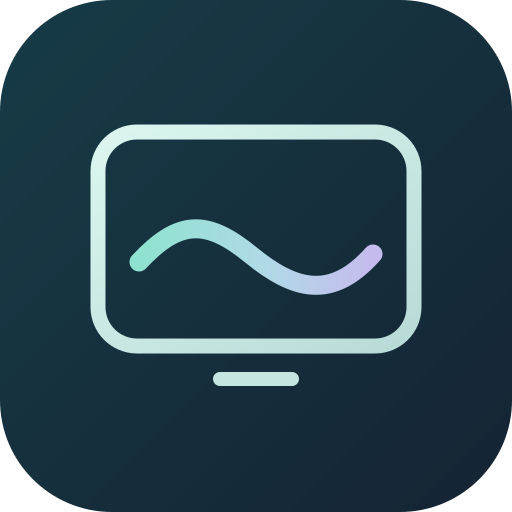
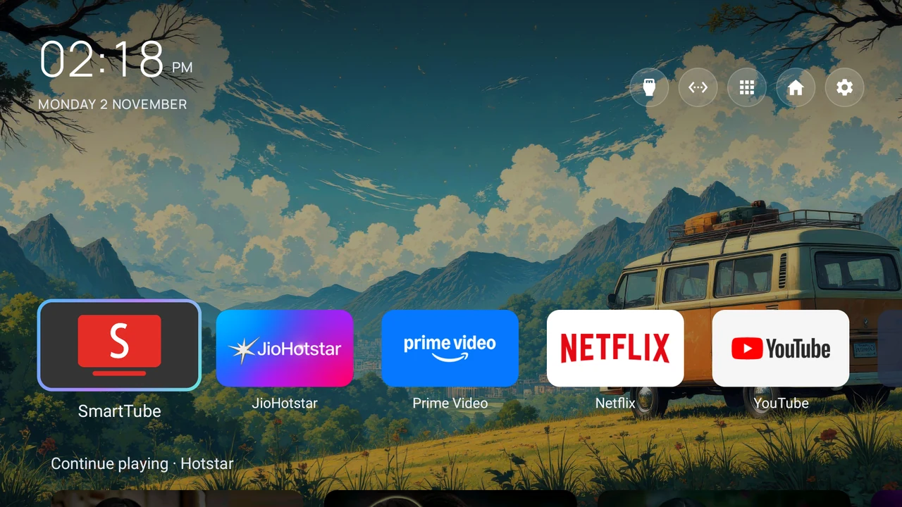
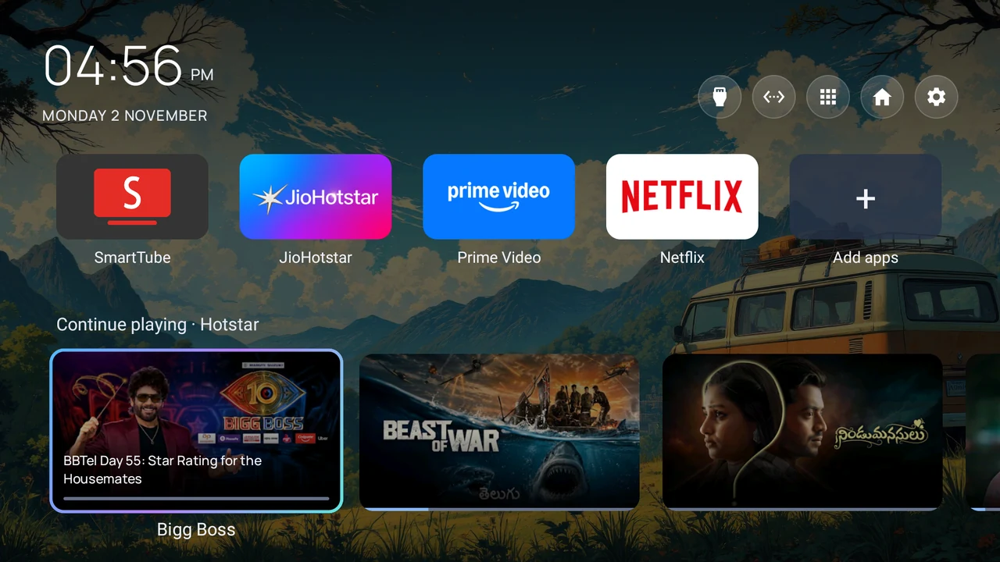
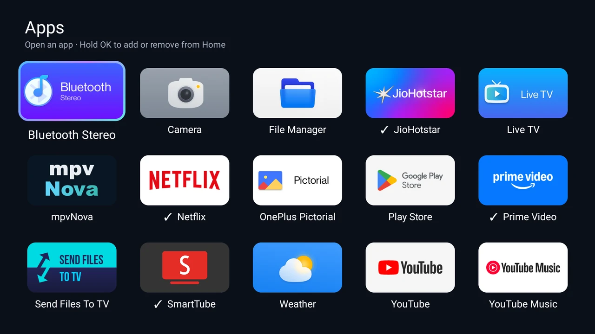
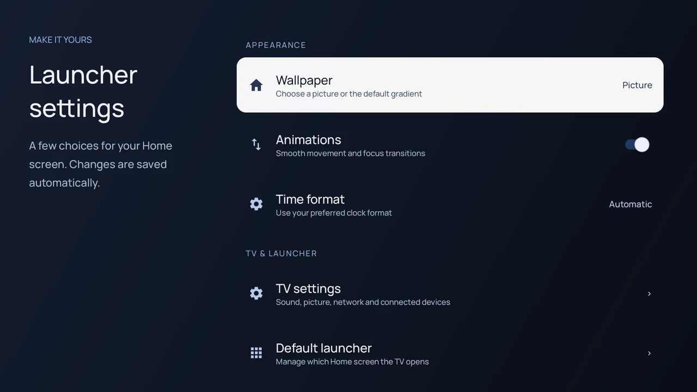

# Ease TV



A calm, remote-first Android TV launcher: a row of favourite apps, large Continue playing cards, and a wallpaper you choose. No recommendation feed or advertising.

**Android package:** `com.ease.tv` · **Android:** 8.0/API 26 or newer · **Project:** `ease-tv-launcher`

Download the APK from [GitHub Releases](https://github.com/stashforge/ease-tv-launcher/releases/latest). See [release history](CHANGELOG.md) for changes.

## Screenshots

Captured on the OnePlus Q1. The example wallpaper and installed apps reflect that TV; fresh installations include the abstract wallpapers bundled with Ease TV.

**Minimal Home**

The favourites row sits near the bottom, leaving room for the wallpaper and a small Continue playing preview.



**Expanded Home and Continue playing**

Press Down to reveal the larger show cards.



**Apps**



**Launcher settings**



## What it does

- A horizontally scrolling favourites row with add, remove and rearrange controls.
- A separate five-column Apps page. Hold an app for its available actions.
- Hotstar Continue playing from Android's local Watch Next provider, including available posters, episode details and progress. Availability depends on what Hotstar publishes on the TV; other services and recommendations are not included.
- Clock and date in Manrope, with automatic, 12-hour or 24-hour time.
- Bundled wallpapers, a gradient, and a built-in local image browser. An external image picker remains available as an alternative.
- JPEG, PNG and WebP imports copied into the app's private storage. Hold an imported wallpaper to remove that copy. The original stays in storage.
- Small wallpaper previews cached in memory, capped at 8 MiB. File changes refresh the preview; removed imports are evicted.
- Inputs, network status and settings shortcuts. Input labels distinguish confirmed connections from the last selected input; selection history is not proof that a device is currently connected.
- Optional animations and a thin gradient focus ring. Focus transitions shorten while holding an arrow key on Home and Apps.
- Continue playing cards enlarge on focus, with a fixed progress bar and fading episode details. Season/episode numbers and estimated time remaining appear when the provider supplies them.

The current UI uses a simulated glass appearance. It does not apply a live background blur.

## Build

Use JDK 17, Android SDK platform 34 and Android build-tools 34.0.0. Set `JAVA_HOME` and `ANDROID_HOME` for your machine, then run:

```sh
./gradlew testReleaseUnitTest lintRelease assembleRelease
```

Windows: use `gradlew.bat` in place of `./gradlew`.

The APK is written to `app/build/outputs/apk/release/app-release.apk`. This personal-build configuration signs release APKs with the local Android debug key. For distributing updates, configure and securely retain your own release signing key. Never commit a signing key.

## Install and choose Home

With ADB connected to your TV:

```sh
adb install -r app/build/outputs/apk/release/app-release.apk
adb shell am start -n com.ease.tv/.MainActivity
adb shell cmd package set-home-activity --user 0 com.ease.tv/.MainActivity
```

On TVs that offer it, the system's default Home app settings can also select Ease TV. Keep the original system launcher installed and available as a fallback, especially while testing. This project does not require removing it.

The old CleanYourTV app and Ease TV have different package IDs. Android does **not** automatically transfer settings between them. Back up the previous app before switching. The package migration performed on the development TV is not an automatic migration feature in this app.

## Remote controls

- Arrows move focus; holding a direction uses shorter focus animations. Apps retains the latest requested position during row scrolling. OK opens the selected app or show.
- Down from favourites reveals Continue playing; Up returns to favourites.
- Hold a favourite for Move or Remove from Home. In Move mode use Left/Right, OK to save, or Back to cancel.
- Hold an app in Apps for its menu. The Add apps page explains its tap/hold behaviour.
- Back closes menus or returns to the previous page.

The optional **Home button** accessibility helper uses keys only. On the tested OnePlus Q1 model, it maps a short Home press to Home and a hold to Apps. Enable it in the TV's accessibility settings if you want that shortcut. This mapping is model-specific and is not claimed to work on every TV. The OnePlus/power button is not remapped; its power menu stays with the firmware.

## Privacy and permissions

- No analytics, account, recommendations, or background polling.
- Internet access is used to retrieve small cached Hotstar poster images when needed. Requests stop when Home is left; there is no recommendation fetch.
- Optional photo access is requested only when opening the built-in local image browser. Android 13+ uses image permissions, with selected-photo access supported on Android 14+. On Android 8–12 it uses the older storage-read permission. The browser lists images indexed by Android; an unindexed file may require a media scan or an external picker.
- Watch Next needs the TV listings permission and a compatible provider. Some firmware requires ADB permission setup, and some may not expose the data at all.
- Fine location is used for the Wi-Fi name where Android requires it. It is not used for weather or tracking.
- The accessibility helper is optional. Secure-settings access is optional infrastructure for restoring enabled helpers, rather than a requirement for browsing the launcher.

The file browser imports image data with a 32 MiB limit and rejects unsupported formats or excessive dimensions. It does not request all-files management access.

## Tested device and limits

The customised UI has been exercised on a OnePlus Q1 (`Oneplus_Dosa_IN`), Android 11/API 30. Other TVs may differ in input APIs, Watch Next permissions, accessibility key delivery, or file indexing. SDK compatibility checks are not a substitute for testing those devices.

Weather has not been implemented. There is no device-owner or accidental-uninstall protection enabled. This project is a launcher, not an automated TV debloating tool.

## Source layout

- `app/src/main/java/com/ease/tv/` — launcher source.
- `app/src/test/java/com/ease/tv/` — unit tests.
- `app/src/main/res/` — UI resources and fonts.
- `app/src/main/assets/` — bundled images and font licences.
- `branding/` — editable SVG logo and preview.
- `THIRD_PARTY.md` — upstream and asset acknowledgements.

## Credits and licence

Ease TV is based on the MIT-licensed [CleanYourTV](https://github.com/Gathin23/cleanyourtv) launcher, with a customised Home UI, app management, Hotstar cards and wallpaper tools. The upstream copyright and licence are retained in [LICENSE](LICENSE).

The bundled abstract landscapes are original MIT-licensed artwork. See [THIRD_PARTY.md](THIRD_PARTY.md) for font and upstream acknowledgements.
